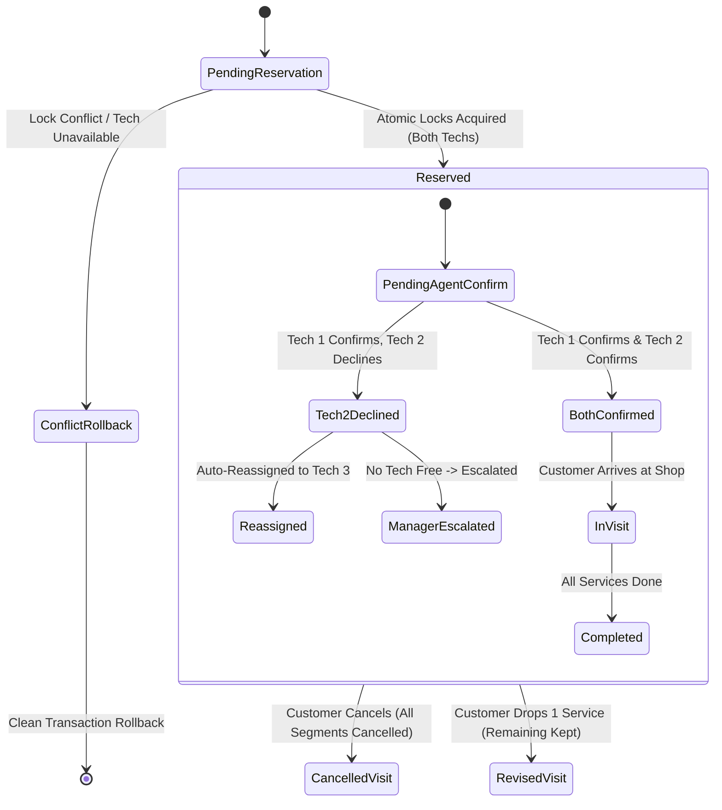

# Data Model: Catalog Service Agent Tagging & Multi-Service Back-to-Back Scheduling

**Feature**: `006-catalog-service-agent-tagging`  
**Date**: 2026-10-15  
**Status**: Completed  

---

## Entities & Schemas

### 1. Catalog Services (`services`)
Existing table defining shop service offerings.

| Column | Type | Constraints | Description |
|---|---|---|---|
| `id` | SERIAL | PRIMARY KEY | Unique service ID |
| `name` | VARCHAR(255) | NOT NULL, UNIQUE | Canonical service name (e.g. "Oil Change") |
| `description` | TEXT | | Service description |
| `price_range` | VARCHAR(100) | | Pricing display (e.g. "$40 - $70") |
| `duration_minutes` | INTEGER | NOT NULL | Service duration in minutes |
| `req_customer_name` | BOOLEAN | DEFAULT TRUE | Intake requirement |
| `req_phone_number` | BOOLEAN | DEFAULT TRUE | Intake requirement |
| `req_vehicle_details` | BOOLEAN | DEFAULT TRUE | Intake requirement |
| `req_issue_description`| BOOLEAN | DEFAULT TRUE | Intake requirement |
| `req_location` | BOOLEAN | DEFAULT TRUE | Intake requirement |

---

### 2. Staff Agents (`staff_agents`)
Existing table representing technicians and service advisors.

| Column | Type | Constraints | Description |
|---|---|---|---|
| `id` | SERIAL | PRIMARY KEY | Unique staff agent ID |
| `name` | VARCHAR(255) | NOT NULL | Staff member full name |
| `role` | VARCHAR(100) | | Role (e.g., "Technician", "Service Advisor") |
| `email` | VARCHAR(255) | | Google account / notification email |
| `phone_number` | VARCHAR(50) | | Mobile number for confirmation SMS |
| `google_access_token` | TEXT | | OAuth access token |
| `google_refresh_token`| TEXT | | OAuth refresh token |
| `google_token_expires_at`| REAL | | Token expiration epoch |

---

### 3. Service Staff Agents Join Table (`service_staff_agents`) [NEW]
Associates catalog services with qualified staff agents.

```sql
CREATE TABLE IF NOT EXISTS service_staff_agents (
    service_id INTEGER NOT NULL REFERENCES services(id) ON DELETE CASCADE,
    staff_agent_id INTEGER NOT NULL REFERENCES staff_agents(id) ON DELETE CASCADE,
    created_at TIMESTAMP WITHOUT TIME ZONE DEFAULT NOW(),
    PRIMARY KEY (service_id, staff_agent_id)
);
CREATE INDEX IF NOT EXISTS idx_ssa_service_id ON service_staff_agents(service_id);
CREATE INDEX IF NOT EXISTS idx_ssa_agent_id ON service_staff_agents(staff_agent_id);
```

| Column | Type | Constraints | Description |
|---|---|---|---|
| `service_id` | INTEGER | FK -> `services.id` ON DELETE CASCADE | Service offering |
| `staff_agent_id`| INTEGER | FK -> `staff_agents.id` ON DELETE CASCADE | Qualified technician/advisor |
| `created_at` | TIMESTAMP | DEFAULT NOW() | Timestamp when tag was created |

**Business Rule**: If a service has 0 rows in `service_staff_agents`, it is treated as **open to all active staff agents**.

---

### 4. Service Requests / Appointments (`service_requests`) [EXTENDED]
Tracks individual service bookings and multi-segment visits.

| Column | Type | Constraints | Description |
|---|---|---|---|
| `id` | SERIAL | PRIMARY KEY | Unique service request ID |
| `customer_id` | INTEGER | FK -> `customers.id` | Customer booking the service |
| `vehicle_id` | INTEGER | FK -> `vehicles.id` | Customer vehicle |
| `service_type` | VARCHAR(100) | | Service name |
| `issue_description` | TEXT | | Symptom or issue details |
| `booking_type` | VARCHAR(50) | `appointment` or `callback` | Booking category |
| `booking_time` | VARCHAR(100) | | Start time (`YYYY-MM-DD HH:MM:SS`) |
| `duration_minutes` | INTEGER | DEFAULT 60 | Segment duration |
| `staff_agent_id` | INTEGER | FK -> `staff_agents.id` | Assigned technician |
| `linked_appointment_id`| INTEGER | FK -> `service_requests.id` | Direct link to companion segment |
| `visit_group_id` [NEW] | VARCHAR(64) | INDEXED | UUID tying all segments of a visit |
| `status` | VARCHAR(50) | DEFAULT 'pending' | Status (`pending`, `confirmed`, `cancelled`, etc.) |
| `confirmation_status` | VARCHAR(40) | | Agent confirmation status |

---

## Lifecycle State Machine for Multi-Segment Visits


